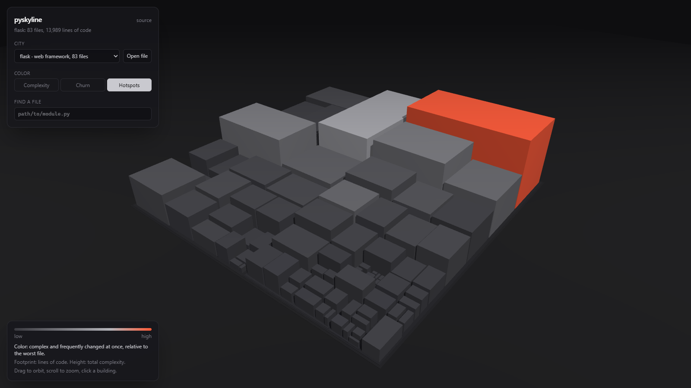
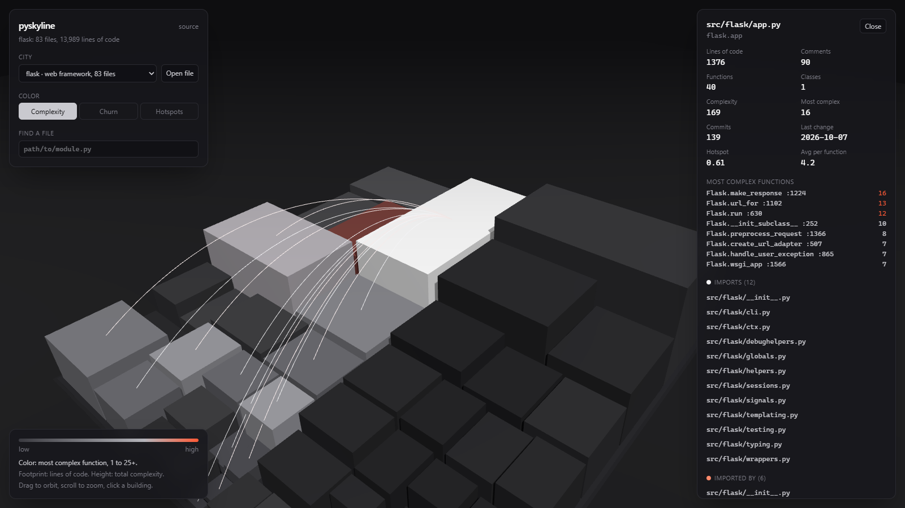

# pyskyline

[](https://github.com/OlexanderPavliuk/pyskyline/actions/workflows/ci.yml)
[](LICENSE)

Turn a Python codebase into a 3D city and see where the risky code lives.

**[Live demo](https://olexanderpavliuk.github.io/pyskyline/)**: Flask, Requests and FastAPI, ready to explore.



- Every **file** is a building. Footprint is lines of code, height is total cyclomatic complexity.
- Every **folder** is a district; nested packages rise as terraces.
- **Color** shows complexity, change frequency, or **hotspots**: files that are both complex
  and changed often, which is where bugs and maintenance cost tend to concentrate.
- Click a building to see its metrics, its most complex functions, and **arcs** to the files it
  imports (white) and the files that import it (orange).



## Usage

Install the CLI (Python 3.13+):

```bash
uv tool install "git+https://github.com/OlexanderPavliuk/pyskyline#subdirectory=analyzer"
# or: pipx install "git+https://github.com/OlexanderPavliuk/pyskyline#subdirectory=analyzer"
```

Analyze a local project or any git URL:

```bash
pyskyline analyze path/to/project -o city.json
pyskyline analyze https://github.com/pallets/flask -o flask.json
pyskyline analyze https://github.com/django/django --depth 500   # only recent history
```

Then open the [viewer](https://olexanderpavliuk.github.io/pyskyline/) and drop `city.json` onto
it. Nothing is uploaded: the file is read in your browser.

```text
$ pyskyline analyze https://github.com/pallets/flask
flask: 83 files, 13989 lines of code, 1462 functions
                         hotspots
 file                       | complexity | commits | hotspot
----------------------------+------------+---------+---------
 src/flask/app.py           |        169 |     139 |    0.61
 ...
```

`pyskyline inspect path/to/module.py` prints the metrics of a single file as a table.

## How it works

```text
analyzer (Python)                                   web (TypeScript)
-----------------                                   ----------------
git ls-files ─┐                                     city.json
              ├─ per file, in worker processes:         │
tokenize ─────┤    line counts                          ├─ squarified treemap -> districts, buildings
ast ──────────┤    functions, McCabe complexity         ├─ Three.js instanced meshes, shadows
              │    imported module names                ├─ raycast hover / click
git log ──────┘  imports resolved to project files      └─ arcs for imports, details panel
                 hotspot score  ─────────> city.json
```

**Lines.** Every physical line is code, comment or blank, decided from `tokenize` tokens, so a
`#` inside a string is not a comment. A line with code and a trailing comment is code; lines
inside multi-line strings, docstrings included, are code.

**Cyclomatic complexity (McCabe).** Each block starts at 1 and gains 1 for every `if`/`elif`,
ternary, `for`/`while`, `except`, non-default `match` case, comprehension `for`/`if`, and extra
`and`/`or` operand. The module and each function are separate blocks: a nested function does
not add to its parent, a lambda does.

**Imports.** Module names follow Python's own rules: the package chain climbs while folders
contain `__init__.py`, so flat and `src/` layouts both work without configuration. Relative
imports are resolved against the importing module; `from pkg import name` maps to `pkg.name`
if that module exists, otherwise to `pkg`.

**History and hotspots.** One `git log --numstat -z` call gives each file's commit count.
The hotspot score is `(complexity / max complexity) × (commits / max commits)`: complex code
nobody touches is cheap, simple code that changes often is cheap, code that is both is not.
Renames are not followed.

**Layout.** Files are placed with a hand-written squarified treemap (Bruls, Huizing and
van Wijk, 2000), which keeps buildings close to square. Folders that only hold one folder are
merged, so `src/flask` is one district rather than two.

## Development

```bash
# analyzer
cd analyzer
uv sync
uv run ruff check && uv run ruff format --check && uv run mypy && uv run pytest

# viewer
cd web
npm ci
npm run dev        # http://localhost:5173
npm run typecheck && npm test && npm run build
```

Both parts run in CI on every push; the viewer deploys to GitHub Pages from `main`.

| Folder | Contents |
|---|---|
| `analyzer/src/pyskyline/metrics/` | line counting, complexity, per-file analysis |
| `analyzer/src/pyskyline/imports.py` | module names and import resolution |
| `analyzer/src/pyskyline/history.py` | git history per file |
| `analyzer/src/pyskyline/project.py` | file discovery, parallel analysis, hotspots |
| `analyzer/src/pyskyline/export.py` | the JSON format the viewer reads |
| `web/src/layout/` | treemap and city layout |
| `web/src/scene/` | Three.js scene, colors, import arcs |
| `web/src/ui/` | selection, hover and the details panel |

## License

[MIT](LICENSE)
